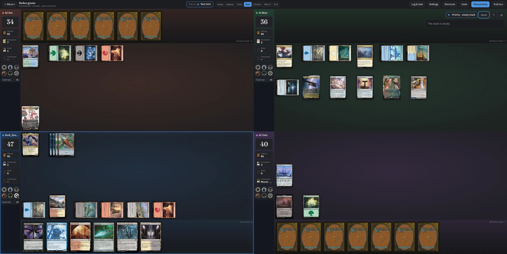
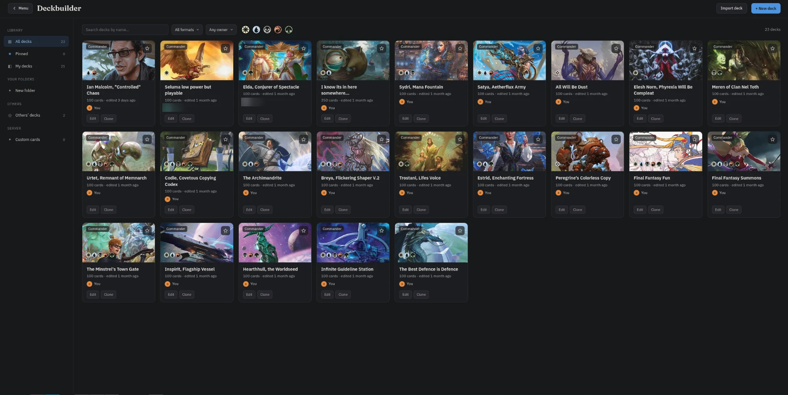
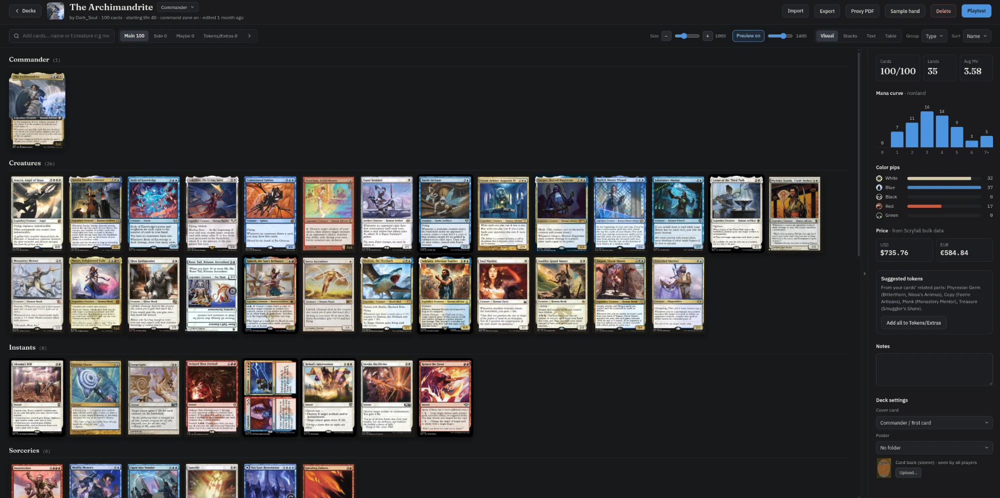
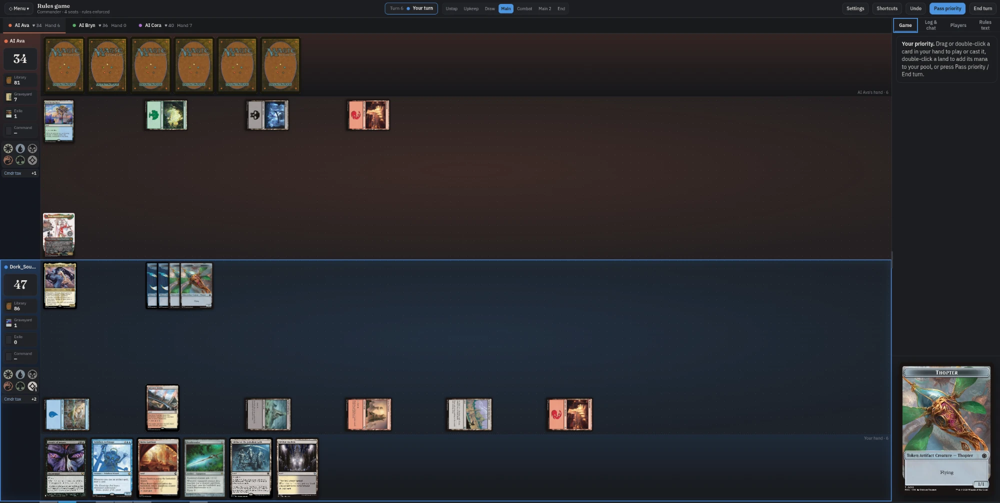
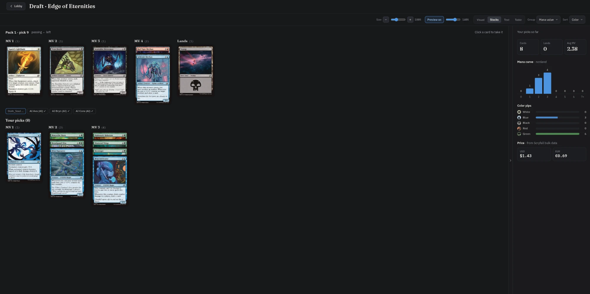

# Aetherhub

Aetherhub is a self-hosted Magic: The Gathering deckbuilder and online tabletop for a group of friends. Build and
import decks, then play them together in the browser, 1–8 players per game. Play on a free-form sandbox table where
you move the cards yourself, or in rules-enforced games run by Aetherhub's own rules engine, with AI opponents to fill
empty seats. Card data and images come from [Scryfall](https://scryfall.com).

Everything runs as one server: the web UI, the API and the live game connection share a single port, and all state
lives in one data folder. Anyone on your network (or on the internet, if you put it behind a reverse proxy) can
join from a browser. Nothing needs to be installed on the players' devices.



## Features

**Decks**

| Deck library | Deck editor |
|---|---|
|  |  |

- Deckbuilder with fast card search using Scryfall-style syntax (`t:`, `o:`, `c:`, `id:`, `mv:`, `pow:`, `r:`, `s:`,
  `is:`, `f:`, comparisons, `or`, `-` and quoted phrases).
- Formats: Commander, Standard, Pioneer, Modern, Legacy, Vintage, Pauper, Brawl, Standard Brawl, Oathbreaker, Cube,
  Limited and Freeform, with legality, deck size, singleton and sideboard checks.
- Import from Moxfield, Archidekt, MTGGoldfish, Arena and MTGO (`.dek`), with a review step. Export to Moxfield,
  Arena and MTGO.
- Sections (commander, companion, sideboard, maybeboard, tokens, planes, schemes, attractions, stickers), folders,
  tags, pinned decks, printing choice, grouping and sorting, and a stats panel.
- Friends can browse and clone each other's decks. Custom cards with your own art. Printable proxy PDFs.
- Official card rulings on every card, plus a rulings search.

**Playing**
- Lobbies for 1–8 players with optional passwords, best-of-one or best-of-three (with sideboarding), and a choice of
  mulligan rules. Planechase and Archenemy are supported. Spectators can be allowed, with their own chat.
- Two ways to play, chosen per lobby:
  - **Sandbox:** a free-form virtual table, like playing in person. Drag cards anywhere, and use counters, tokens,
    arrows, dice, dungeons and the Ring, hand reveals, and undo with the host's approval.
  - **Rules enforced:** Aetherhub's own rules engine runs the game by the real rules. Priority, the stack, combat,
    costs and triggers are handled for you, and it can explain why something isn't allowed. Undo works with the
    other players' agreement. "Break the rules" lets you fix the board by hand when needed.
- AI opponents (Easy, Normal, Hard) can fill any number of seats in rules-enforced games.
- Draft and Sealed with real set boosters (Play Boosters and Draft Boosters with published rarity odds). Pods of 2–8
  mix people and AI drafters, with an optional pick timer. Build your deck from the pool with suggested lands.
- Solo play to goldfish or playtest a deck. Games can be suspended, saved and resumed, and survive a server restart.
  Match history keeps every game's full log.

| Rules-enforced game, side panel layout | Draft |
|---|---|
|  |  |

**Rules engine**
- Written in Rust. More than 33,000 cards are defined as data (`cards/`), and each card is checked by scenario tests
  and random-play smoke tests. Cards the engine doesn't support yet are marked in the deckbuilder and left out of
  rules-enforced games with a warning.

**Hosting**
- Admin-managed accounts (no public sign-up), login rate limiting, user roles.
- Scryfall card data is downloaded and refreshed automatically, and card images are cached on your server.
- Built-in database backups and restore. Dark and light themes, accent colours, table styles, sounds and hotkeys.
  Installable as a web app on phones and desktops.

## Quick start

Pick one of the two ways to run it. Either way, on first start:

1. Open the address it prints (default `http://localhost:8080`) and **create the admin account**.
2. Wait about a minute while it downloads Scryfall's card data (~500 MB, once; re-checked weekly).
3. Add accounts for your friends under **Settings → Users**, and send them the address.

### Option A: Docker Compose

Needs [Docker](https://docs.docker.com/get-docker/) with Compose. Download
[`docker-compose.yml`](https://raw.githubusercontent.com/DorkSoul/aetherhub/main/docker-compose.yml) into an empty
folder, then in that folder:

```bash
docker compose up -d
```

Then open `http://<your-computer>:8080`. Data is kept in the `aetherhub-data` volume, so updating doesn't lose it.
To update to the latest release: `docker compose pull && docker compose up -d`.

To build the image from source instead, clone this repository and run
`docker build -t ghcr.io/dorksoul/aetherhub:latest . && docker compose up -d` in it (the first build compiles the
rules engine and takes several minutes).

### Option B: standalone app (no Docker)

Download the file for your system from the [latest release](https://github.com/DorkSoul/aetherhub/releases/latest):

| System | File | How to start |
|---|---|---|
| Linux (x86-64) | `Aetherhub-<version>-x86_64.AppImage` | `chmod +x Aetherhub-*.AppImage`, then run it |
| Windows 10/11 (x64) | `Aetherhub-<version>-windows-x64.zip` | Unzip it anywhere and run `Aetherhub.exe` |

A small Aetherhub window opens. It shows the address for this computer and the one other devices on your home
network can use, and the browser opens automatically once the server is ready. **Closing that window (or its Stop
button) stops Aetherhub**; running games are saved first. The server's log is `aetherhub.log` in the data folder.
On a machine without a desktop, the Linux version runs in the terminal instead (or pass `--no-gui`): Ctrl+C stops it.

- **Windows:** the app isn't code-signed, so SmartScreen may say "Windows protected your PC": choose **More info →
  Run anyway**. Allow access when the firewall asks, otherwise only this computer can connect.
- **Linux:** AppImages need FUSE 2 (`libfuse2` / `fuse2` package). Without it, run
  `./Aetherhub-*.AppImage --appimage-extract-and-run`.

Each release also has a `SHA256SUMS` file: to check a download, compare the output of `sha256sum <file>` (Linux) or
`certutil -hashfile <file> SHA256` (Windows) with the line for that file.

Data is stored per user: `~/.local/share/aetherhub` on Linux, `%LOCALAPPDATA%\Aetherhub` on Windows. Set `DATA_DIR`
to use another folder, and `PORT` to use another port. The standalone app is meant for your home network. To make it
reachable from the internet, use the Docker setup behind a reverse proxy (see below).

## Running it for others

**Reverse proxies and tunnels.** Point Caddy, nginx, Traefik, cloudflared, Pangolin or similar at the single port.
WebSockets must be allowed (most proxies pass them through by default). The server sends a heartbeat every 25 s so
idle tunnels don't drop the connection. Use HTTPS for anything reachable from the internet: the login page and the
admin Users page warn when someone signs in from outside the LAN over plain HTTP.

**Configuration** (environment variables; in Compose, add them under `environment:`):

| Variable | Default | |
|---|---|---|
| `PORT` | `8080` | port for the UI, API and WebSocket |
| `BASE_PATH` | `/` | serve under a sub-path, e.g. `/aether/` |
| `DATA_DIR` | `/data` in Docker | SQLite databases, image cache, uploads, backups |
| `TRUST_PROXY` | private networks | whose `X-Forwarded-*` headers to believe (client IP, Secure cookies). By default proxies on loopback or private addresses, such as a tunnel client on the same host. `false` = none, `true` = any peer (only if nothing else can reach the port), or a comma-separated list of IPs / CIDRs |
| `SCRYFALL_UA` | `Aetherhub/1.0 (self-hosted MTG table)` | User-Agent sent to Scryfall |
| `NO_AUTO_DOWNLOAD` | unset | `1` = never download card data automatically |
| `SEED_CARDS` | unset | path to a Scryfall *Default Cards* bulk file to import when no card database exists |

**Offline or slow connection?** Download Scryfall's *Default Cards* bulk file yourself and put the
`default-cards-*.json` file in the data folder before the first start (Docker:
`docker compose create && docker cp default-cards-….json aetherhub:/data/ && docker compose start`).

**Backups.** A backup of the app database is taken before every schema migration and on demand under
**Settings → Backups**. The last 5 are kept in `<data>/backups`, and a backup can be restored from the same page.
Card data is not backed up because it is downloaded again.

**Locked out of the admin account?** Run one of these to print a temporary password:

```bash
docker exec aetherhub npm run reset-password -- <username>   # Docker
./Aetherhub-*.AppImage reset-password <username>               # Linux standalone
Aetherhub.exe reset-password <username>                        # Windows standalone (from a terminal)
```

## Development

### Layout

| Path | What it is |
|---|---|
| `packages/client` | React + Vite web UI |
| `packages/server` | Fastify + `ws` + SQLite (`node:sqlite`) server: accounts, decks, card import, image cache, lobbies, games |
| `packages/shared` | card and deck model, search parser, legality, import/export, the sandbox table's game reducer, redaction of hidden information |
| `packages/rules` | TypeScript bindings for the rules engine addon |
| `engine/` | the rules engine in Rust: `mtg-engine` (rules), `mtg-cards` (card loader, scenario tests), `mtg-ai` (AI players), `mtg-node` (Node addon) |
| `cards/` | one JSON definition per card, plus scenario tests in `cards/tests/`. See [`cards/README.md`](cards/README.md) for the card format |
| `decks/` | sample decks used by the engine's AI and fuzz tools |
| `e2e/` | Playwright end-to-end tests |
| `fixtures/` | a small card database (~470 printings) so tests don't need the full Scryfall file |
| `packaging/` | the standalone release builder and its launcher |

### Prerequisites

- Node.js 22.13 or newer (24 recommended)
- Rust (stable) for the rules engine
- Docker or Podman, only for building the image or the standalone releases

### Running locally

```bash
npm ci
npm run rules:build                       # compile the rules engine addon (engine/target/release)
npm run dev -w @aetherhub/server          # API on :8080 (restarts on change)
npm run dev -w @aetherhub/client          # Vite on :5173, proxies /api, /img and /ws to :8080
```

Or run a production build: `npm run build && DATA_DIR=./data npm start`.

### Tests

Two levels:

```bash
npm run test:affected     # quick: only what covers your changes (seconds to ~15 min)
npm run test:full         # everything, before a release (about an hour)
```

`test:affected` looks at the files changed since the last commit (or `-- --since <ref>`) and runs:

| What changed | What runs |
|---|---|
| card files (`cards/<X>/<Name>.json`, `cards/tests/<Name>.json`) | those cards: compile, scenarios, random play |
| engine Rust code | fast engine build, the engine's own tests, and the scenarios of the cards using the DSL types and rules areas the change touches (plus `cards/core`) |
| TypeScript (`packages/`, `e2e/`) | typecheck and unit tests; browser tests when the client, server or e2e changed |

Engine code is shared by many cards, so a change can still break one the quick run didn't pick: that is what
`test:full` (every scenario of every card, every card in random play, all tests, generated files up to date) is for.

The individual commands:

```bash
npm run typecheck
npm test                                  # Vitest: shared logic, server API + WebSocket, rules engine bindings
npm run build && npx playwright test      # end-to-end: several browser contexts per game, fixture card database
cd engine && cargo test --release --workspace
engine/target/release/cards validate      # every card definition compiles
engine/target/release/cards test          # every card's scenario tests
engine/target/release/smoke --all         # every card survives random play
```

A full `cards test` or `smoke --all` loads the whole card database (about 0.7 GB of memory). Pass card names to run
just those, e.g. `engine/target/release/cards test Lightning_Bolt`. For quicker engine builds while working, use
`cargo build --profile fast` (no link-time optimisation; binaries in `engine/target/fast`).

### Adding or fixing cards

Card behaviour is data. Each card is a JSON file under `cards/` written in the engine's card DSL, and it needs
scenario tests in `cards/tests/`. [`cards/README.md`](cards/README.md) explains the format, the tools and the
checklist. `cards/schema.json` is the machine-readable schema (regenerate it with
`engine/target/release/cards schema > cards/schema.json` after changing the DSL). If you change engine types that
the UI uses, regenerate the TypeScript bindings with `npm run rules:types`.

### Building releases

```bash
docker build -t ghcr.io/dorksoul/aetherhub:latest .   # the Docker image
npm run dist                              # standalone releases into release/ (Linux AppImage + Windows zip)
bash packaging/build.sh linux             # or just one of them: linux | windows
```

`packaging/build.sh` builds the web UI and server, compiles the rules engine and the launcher for Linux and Windows
in a container (`packaging/Dockerfile`), downloads the matching Node.js runtime, and packs everything.

### Making a release

The tests run locally, not on GitHub, so a release costs no Actions minutes beyond building the image.

1. Set the version (e.g. `1.1.0`) everywhere: `npm version 1.1.0 --workspaces --include-workspace-root
   --no-git-tag-version`, plus `version` in `packages/server/src/config.ts` and `packaging/launcher/Cargo.toml`.
2. Run `npm run test:full` and `npm run dist`.
3. Commit, tag and push: `git tag v1.1.0 && git push && git push origin v1.1.0`.
4. Publish the release with the two files and their checksums:
   `gh release create v1.1.0 release/Aetherhub-1.1.0-* --title "Aetherhub 1.1.0" --generate-notes`

Pushing the tag starts `.github/workflows/container.yml`, which only builds the Docker image and publishes it as
`ghcr.io/dorksoul/aetherhub:<version>` and `:latest`. It can also be started by hand from the Actions tab.

## License

Aetherhub is free software under the [GNU General Public License v3.0 or later](LICENSE).

Card data and images are provided by [Scryfall](https://scryfall.com) and fetched by each server from Scryfall's API.
Aetherhub is unofficial Fan Content permitted under the Fan Content Policy. Not approved/endorsed by Wizards. Portions
of the materials used are property of Wizards of the Coast. ©Wizards of the Coast LLC. Magic: The Gathering and its
card names, text and art are trademarks and copyrights of Wizards of the Coast.
